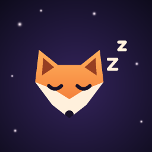
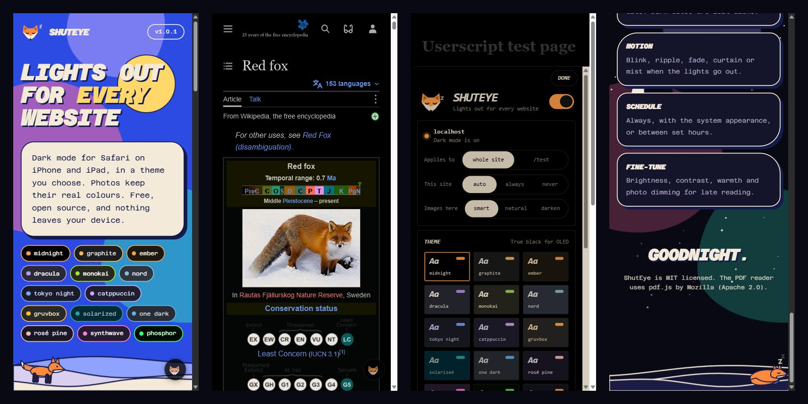

<p align="center">
  
</p>

<h1 align="center">ShutEye</h1>

<p align="center">
  <b>Lights out for every website.</b><br>
  Dark mode in a theme you choose, for Safari on iPhone and iPad, and for Chrome and Edge on Windows, Mac and Linux.<br>
  Free to use, and nothing leaves your device.
</p>

<p align="center">
  <a href="https://advaithsajith.github.io/shuteye/"><b>Install on iPhone or iPad</b></a>
  &nbsp;·&nbsp;
  <a href="https://github.com/advaithsajith/shuteye/releases/latest/download/shuteye-desktop.zip"><b>Download for desktop</b></a>
  &nbsp;·&nbsp;
  <a href="https://advaithsajith.github.io/shuteye/reader/"><b>Dark PDF reader</b></a>
</p>

<p align="center">
  
</p>

The mascot is a fox that sleeps while ShutEye is on and wakes up when you
switch it off.

## Install

| Device | How | Time |
| --- | --- | --- |
| **iPhone, iPad** | Open the [install page](https://advaithsajith.github.io/shuteye/) in Safari and follow the four steps. Uses the free Userscripts app. | 3 minutes |
| **Windows, Mac, Linux** (Chrome, Edge, Brave) | [Download the zip](https://github.com/advaithsajith/shuteye/releases/latest/download/shuteye-desktop.zip), unzip it, open `chrome://extensions`, turn on **Developer mode**, choose **Load unpacked**, and pick the unzipped `shuteye` folder. | 2 minutes |
| **Safari with a Mac** | Build the real Safari extension with Xcode. See [Install with a Mac](#install-with-a-mac-real-safari-extension). | 15 minutes |

## What it does

- **Darkens any website**, including long Wikipedia articles, while keeping photos and video in their real colours.
- **Tells pictures apart.** Diagrams, formulas, line art and scanned book pages go dark with the page. Photos stay natural.
- **15 themes**: Midnight (true black for OLED), Graphite, Ember (warm sepia), Dracula, Monokai, Nord, Tokyo Night, Catppuccin, Gruvbox, Solarized, One Dark, Rosé Pine, Synthwave, Phosphor, and **Custom** (pick your own background, text and accent colours).
- **Fine-tuning**: brightness, contrast and warmth sliders, photo dimming for bright pictures at night, and an option to paint links in the theme's accent colour.
- **Switch animations**: Blink (the page shuts like an eyelid), Ripple, Fade, Curtain, Mist, or off. You set the speed.
- **Per-site rules**: Auto, Always or Never for each site, or for one section of a site (Google Docs but not Sheets), plus a mode that only darkens sites you pick.
- **Leaves dark sites alone.** It checks each page's own colours first.
- **Schedule**: always on, follow the device's Light/Dark appearance, or set hours.
- **Dark PDF reader** with your theme, text selection and search. It remembers your page in each book.
- **PDF annotation**: highlight, underline and strike through text, draw with a pen, pin notes and type on the page. A side panel lists every annotation and the PDF's outline, and you can save a copy of the PDF with the annotations drawn in.
- **Reading mode**: one tap (or Alt+Shift+R) shows just the article in your theme, with your choice of typeface, text size and column width. Menus, sidebars and comment sections are left out.
- **A theme per site**: Dracula on one site, Ember on another, whatever your everyday theme is.
- **Black and white mode** and a keyboard switch (Alt+Shift+D on a computer).

## Two ways to install

| | You need | Keeping it running |
| --- | --- | --- |
| **No Mac: userscript** (next section) | The Userscripts app from the App Store | Nothing to renew |
| **Mac: real Safari extension** (further down) | A Mac with Xcode, and a cable | Re-run from Xcode every 7 days |

Both are the same ShutEye. The userscript has no toolbar popup, so its controls
open from a small fox button in the corner of the page.

## Install without a Mac

The `docs` folder is a ready-made website: an install page, the userscript
(`shuteye.user.js`) and the PDF reader. Put it online once, then install from
your phone.

1. **Put it online.** Create a GitHub repository, upload this project, and in the
   repository's **Settings > Pages** choose **Deploy from a branch**, branch `main`,
   folder `/docs`. Your install page is then at `https://YOURNAME.github.io/REPO/`.
2. **On the iPhone or iPad**, install **Userscripts** from the App Store and open it once.
3. Turn it on: **Settings > Apps > Safari > Extensions > Userscripts**, allow the
   extension, and allow it on **All Websites**.
4. Open your install page in Safari and tap **Install ShutEye**. When the script
   opens, tap the page-menu button in the address bar, choose **Userscripts**, and
   tap the install prompt.
5. Reload any website. It goes dark and the fox appears. Tap the fox for themes
   and settings. If you hide the fox, hold two fingers still on the page for a
   second to open the panel.

Visit your install page once after installing: it tells ShutEye where the PDF
reader lives, which adds an **Open the dark PDF reader** button to the panel.

Limits of this route: it cannot run on Safari's own pages (the start page and
the built-in PDF viewer), a few sites with very strict security rules may block
the settings panel (the darkening still works), and other open tabs pick up
changed settings when you return to them.

After changing any code, run `node tools/build-userscript.js` to rebuild `docs/`.

## Folder layout

```
shuteye/
  extension/            the Safari Web Extension (this is what Xcode wraps)
    manifest.json       tells Safari what the extension is and where it runs
    shared.js           themes, settings and colour maths
    content.js          runs on every page and does the darkening
    popup.html/.css/.js the control panel you open from Safari's toolbar
    reader.html/.css/.js the dark PDF reader
    images/             the fox icon in every size
    vendor/             pdf.js (Mozilla's open-source PDF engine)
  userscript/           extra pieces for the no-Mac version (storage, fox button, install page)
  docs/                 the built no-Mac version, ready for GitHub Pages
  build-on-mac.sh       one command that creates the Xcode project
  tools/                build-userscript.js rebuilds docs/, make-icons.js redraws the icons
  test/                 pages used to test the extension in a desktop browser
```

## Install with a Mac (real Safari extension)

**You need:** a Mac with Xcode (free from the Mac App Store), a free Apple ID, a
cable, and iOS or iPadOS 15 or later. Apple only lets a Mac put your own app on
an iPhone, so there is no way around the Mac for this step. A borrowed Mac works.

### 1. Copy this folder to the Mac

Copy the whole `shuteye` folder over (AirDrop, USB stick or a cloud drive).

### 2. Create the Xcode project

Open the **Terminal** app on the Mac, type `cd ` (with a space), drag the
`shuteye` folder into the window, and press Return. Then run:

```bash
chmod +x build-on-mac.sh
```

```bash
./build-on-mac.sh yourname
```

Use your own name in place of `yourname`, letters and numbers only. Xcode opens
with a project called ShutEye. Apple's converter wrote the Swift app for you.

If the script fails, do it by hand: in Xcode choose **File > New > Project > iOS >
Safari Extension App**, name it ShutEye, then replace everything in the
extension's **Resources** folder with the contents of `extension/`.

### 3. Sign it with your free Apple ID

1. In Xcode, open **Xcode > Settings > Accounts**, press **+**, and sign in with your Apple ID.
2. Click the blue **ShutEye** project icon at the top of the left sidebar.
3. Select the **ShutEye** target, open **Signing & Capabilities**, and set **Team** to your name (Personal Team).
4. Select the **ShutEye Extension** target and set the same Team.

### 4. Put it on your device

1. Plug the iPhone or iPad into the Mac and tap **Trust** on the device.
2. Turn on Developer Mode on the device: **Settings > Privacy & Security > Developer Mode**, then restart when asked. (The switch appears after the device has been connected to Xcode once.)
3. In Xcode, pick your device from the menu at the top of the window and press the **Run** button (the triangle).
4. The first time, the device refuses to open the app. Go to **Settings > General > VPN & Device Management**, tap your Apple ID, and tap **Trust**. Press Run again.

### 5. Turn it on in Safari

1. Open **Settings > Apps > Safari > Extensions > ShutEye**. (On iOS 17 or earlier: **Settings > Safari > Extensions**.)
2. Turn on **Allow Extension**.
3. Under Permissions, set **Other Websites** to **Allow**. Without this, Safari asks on every site.

Open Safari, load any page, tap the page menu button in the address bar, and
tap **ShutEye** to open the control panel.

Repeat steps 4 and 5 for each device.

### The 7-day rule

Apps signed with a free Apple ID stop opening after 7 days. To renew, plug the
device in and press Run in Xcode again. Your settings are kept. A paid Apple
Developer membership ($99 a year) extends this to a year, but you do not need it.

## Reading PDFs

Safari shows PDFs in its own viewer, and Apple does not let extensions restyle
it. So ShutEye has its own reader:

- **A PDF open in Safari:** tap ShutEye, then **Open this PDF in the dark reader**.
- **A PDF saved in Files:** tap ShutEye, then **Open the dark PDF reader**, then **Choose a PDF**.

The **Photos** button keeps pictures inside the PDF in their real colours.
Full-page scans count as pages, not photos, so they still go dark. PDFs behind
a login may not load from a link; save them to Files and open them from there.

PDF pages shown inside a web page (web-based viewers and online book readers)
are handled by the normal website darkening.

## If something looks wrong

| Problem | Fix |
| --- | --- |
| A site was already dark and now looks light | Set **This site** to **Never**. |
| A dark site was skipped but you want your theme on it | Set **This site** to **Always**. |
| Book pages or comics stay bright white | Set **Images here** to **Darken**. |
| Photos look like negatives | Set **Images here** to **Natural**. |
| The page is covered by a flat colour | Open **Fine-tune** and turn off **Colour tint**. You get a gray version of the theme. Please note which theme and site. |
| Nothing happens on a page | Reload it. Pages that were open before ShutEye was installed need one reload. |
| No switch animation | Animations need iOS 18 or later, and are skipped if Reduce Motion is on. |
| Scrolling feels slow on a very heavy page | Set **This site** to **Never** for that site. |

## Trying it on a Windows or Mac desktop first

The `extension` folder is a standard Manifest V3 extension, so Chrome and Edge
should load it without a Mac: open `chrome://extensions`, turn on **Developer mode**,
choose **Load unpacked**, and pick the `extension` folder. (This route has not
been tried yet either; the testing below used the pages in `test/`.)

## How it works

One CSS filter on the page swaps light and dark while keeping hues, so blue
links stay blue. Photos, video and frames get the same filter a second time,
which cancels out and restores them. For colour themes, two see-through layers
(screen and multiply blends) remap the page so white lands exactly on the
theme's background colour and black on its text colour. The PDF reader applies
the same maths directly to each page's pixels.

To add your own theme permanently, add one line to the `THEMES` list at the top
of `extension/shared.js`.

## What has been tested

The darkening engine, popup and PDF reader were tested in a desktop Chromium
browser using the pages in `test/`, including the userscript build. Nothing has
been run on a real iPhone, in Safari, or inside the Userscripts app yet, and the
Xcode step has not been run, because this was built on Windows. Expect to find
a few Safari-specific quirks on first install.

## Licence

Copyright © 2026 Advaith Sajith. All rights reserved. ShutEye is free for personal use; see [LICENSE](LICENSE). pdf.js is by Mozilla, under the Apache 2.0 licence
(`extension/vendor/PDFJS-LICENSE.txt`).
